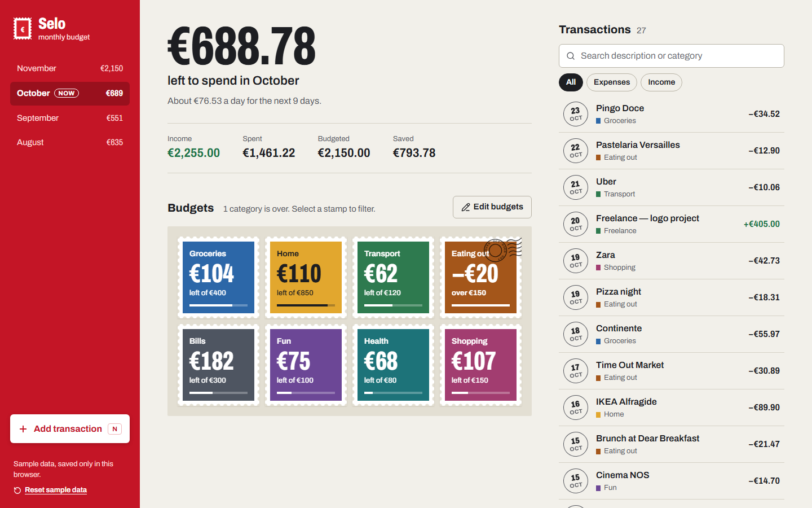
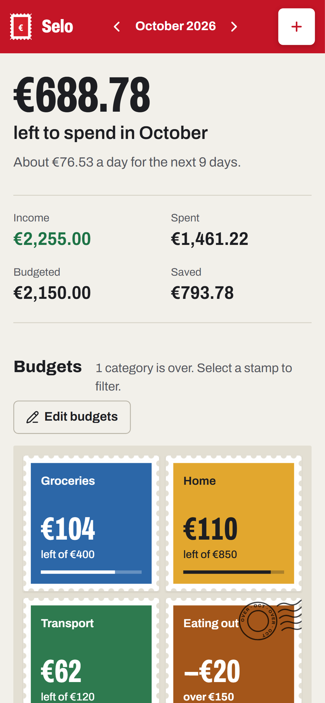

# Selo — monthly budget tracker

[](https://github.com/Kroketez/selo-budget/actions/workflows/deploy.yml)
[](LICENSE)

**[Live demo →](https://kroketez.github.io/selo-budget/)**

A personal budget tracker built around one question: **how much can I still spend this month?**
Every category budget is drawn as a postage stamp whose face value is what's left. Go over, and the stamp gets a postmark.

Built with **React 19 + TypeScript + Vite**, tested with **Playwright**. No backend: data lives in `localStorage`, and sample data loads on first visit.

<p>
  
  &nbsp;
  
</p>

## Features

- Add, edit and delete income and expenses (amount, description, category, date)
- Delete with **Undo**
- Monthly budgets per category, editable in place
- "Left to spend" headline with a daily allowance for the rest of the month
- Month navigation with remaining amount per month
- Search, filter by type, or click a stamp to filter by category
- Form validation with clear error messages
- Keyboard shortcut: press **N** to add a transaction
- Responsive from phone to desktop, accessible labels and focus states, respects reduced motion

## Run it

```bash
npm install
npm run dev
```

Build for production (outputs to `dist/`, uses relative paths so it works on GitHub Pages):

```bash
npm run build
```

## Tests

End-to-end tests in [`tests/`](tests/budget.spec.ts) cover adding, validating, editing, deleting with undo, filtering, budget editing, month navigation, saving and resetting — on both a desktop and a phone viewport. The clock is frozen, so results don't depend on today's date.

```bash
npx playwright install chromium   # first time only
npm test
```

GitHub Actions runs the linter and the tests on every push and pull request. The site only deploys when they pass.

To refresh the README screenshots: `npm run screenshots`.

## Ship a change

Build, commit everything and push to GitHub in one command. The site at
https://kroketez.github.io/selo-budget/ redeploys automatically.

```bash
npm run ship "what you changed"
```

If the build fails, nothing is committed or pushed.

## Project structure

```
src/
  App.tsx                 main screen and state wiring
  store.ts                reducer + localStorage persistence
  data.ts                 categories, default budgets, sample data
  format.ts               money and date helpers
  useTicker.ts            animated number hook
  components/
    Rail.tsx              sidebar / mobile top bar, month navigation
    Stamp.tsx             category budget stamp + postmark
    Composer.tsx          add / edit transaction form
    TransactionList.tsx   searchable, filterable list
```
